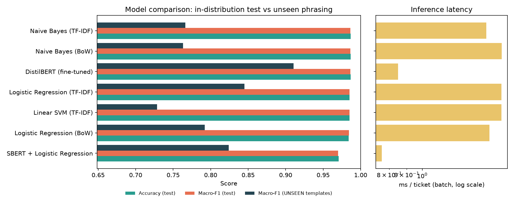
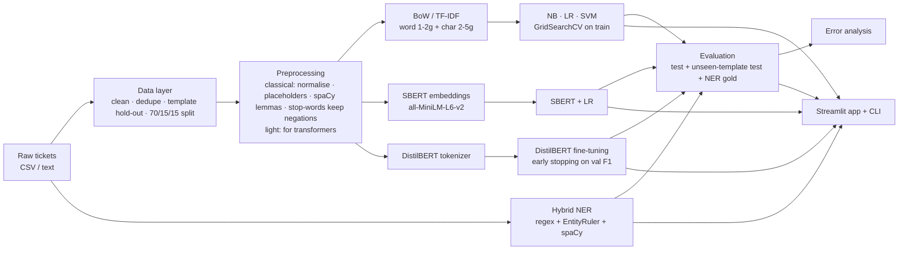

# University Helpdesk Ticket Classifier

**ETMMTI303 – Language Technologies and Text Intelligence · MCA (AI & ML) Sem III · Capstone Topic 13**

An end-to-end NLP system that reads a free-text university helpdesk ticket and:

1. **routes it** to one of 5 departments (`IT_WiFi`, `LMS_Portal`, `Academics_Exams`, `Fees_Accounts`, `Hostel_Facilities`) with a confidence score,
2. **compares** classical models (Naive Bayes, Logistic Regression, Linear SVM) with transformer models (SBERT + LR, fine-tuned DistilBERT),
3. **extracts key entities**: student IDs, course codes, error codes, amounts, transaction IDs, rooms, departments, systems, dates and people,
4. assigns a rule-based **priority**, and presents everything in a **Streamlit dashboard** (single ticket, batch upload, analytics, model performance).

---

## Results (held-out test sets; real numbers from `reports/model_comparison.csv`)

| Model | Test acc. | Test macro-F1 | **Unseen-template macro-F1** | Val macro-F1 | ms/ticket (batch) | Train time | Size |
|---|---|---|---|---|---|---|---|
| Naive Bayes (TF-IDF) | 0.9867 | 0.9865 | 0.7661 | 0.9870 | ~1.5 | 61 s (grid) | 0.8 MB |
| Logistic Regression (TF-IDF) | 0.9853 | 0.9852 | 0.8450 | **0.9895** | ~1.7 | 24 s (grid) | 1.0 MB |
| Linear SVM (TF-IDF, calibrated) | 0.9853 | 0.9851 | 0.7285 | 0.9882 | ~1.7 | 34 s (grid) | 1.7 MB |
| SBERT (MiniLM) + LR | 0.9707 | 0.9699 | 0.8243 | 0.9813 | ~0.8 (GPU) | 72 s | 92 MB |
| **DistilBERT (fine-tuned)** | 0.9867 | 0.9863 | **0.9106** | 0.9868 | ~0.8 (GPU) | 54 s (GPU) | 269 MB |
| Naive Bayes (BoW) *comparison* | 0.9867 | 0.9865 | 0.7632 | 0.9884 | ~1.7 | 0.3 s | 0.8 MB |
| Logistic Regression (BoW) *comparison* | 0.9840 | 0.9843 | 0.7922 | 0.9881 | ~1.6 | 0.7 s | 0.5 MB |

* **Test set** (750 tickets): same templates as training. All models score about 0.985, and the differences are 1–3 tickets, i.e. not meaningful. Of the best model's 11 errors, 9 are deliberately mis-filed gold labels.
* **Unseen-template test set** (845 tickets from 20 phrasing templates removed *before* splitting): this is where the models separate. **DistilBERT keeps 0.91 macro-F1, TF-IDF+LR drops to 0.85, NB/SVM to 0.73–0.77.** This is the evidence that the transformer generalises better to new wording. It was not assumed.
* **Trade-off:** DistilBERT is ~270× larger than the linear models and needs a GPU for fast training. TF-IDF+LR is tiny, CPU-only and directly interpretable. Selection on validation picks TF-IDF+LR (0.9895), but on new phrasing DistilBERT is clearly safer.
* **NER** (50 hand-labelled tickets): micro-F1 **0.968** (P 0.976 / R 0.960); 42/50 tickets fully correct. Misses are unusual formats (`ERR-504`, `E1021`, `CSE-205`, `Lab-3`, `Hostel D 210`).
* Latency was measured on an RTX 4050 laptop GPU / Intel CPU; see `single_ticket_latency_ms` in the CSV for one-ticket latency (3–20 ms).

Success criteria: macro-F1 ≥ 0.85 ✅ (0.986 test; 0.91 for DistilBERT even on unseen templates) · NER ≥ 80% of sampled tickets correct ✅ (84%, 42/50) · app works on unseen text ✅.



---

## Architecture



Course blueprint: Raw text → Preprocessing → Representation → Classical baseline → Transformer → Evaluation → Error analysis → UI → Visualisation → Demo.

---

## Setup

Python **3.10–3.12** (tested on 3.12, Windows 11).

```bash
cd helpdesk-ticket-classifier
python -m venv .venv
# Windows: .venv\Scripts\activate        Linux/macOS: source .venv/bin/activate
# optional GPU: pip install torch --index-url https://download.pytorch.org/whl/cu126
pip install -r requirements-dev.txt     # app only: requirements.txt (includes the spaCy model)
```

## Deploying to Streamlit Community Cloud

1. Push this folder to a **public** GitHub repo (`artifacts/distilbert_helpdesk/model.safetensors` is git-ignored, since it is over GitHub's 100 MB limit).
2. Attach the weights to a release: `gh release create v1.0-models artifacts/distilbert_helpdesk/model.safetensors --title "Model weights"`.
3. Check that `deploy.distilbert_weights_url` in `config.yaml` points to that release asset.
4. At [share.streamlit.io](https://share.streamlit.io), click **Create app**, pick the repo, branch `main`, main file `app.py`. Any Python version from 3.12 to 3.14 works: `requirements.txt` pins the tested versions and uses only prebuilt packages, so nothing is compiled during the build.

On its first start, the app installs CPU-only torch (about 1 GB RAM in use with all 5 models) and downloads the DistilBERT weights (about 2 minutes). If the download fails, it runs with the other four models.

## Run order

```bash
python -m src.data.generate_dataset        # 1. synthetic data      -> data/raw/
python -m src.data.clean_split             # 2. clean + split       -> data/processed/
python -m src.models.train_classical       # 3. NB / LR / SVM (+BoW) -> artifacts/classical/
python -m src.models.train_embedding_lr    # 4. SBERT + LR, UMAP    -> artifacts/sbert_lr/
python -m src.models.train_transformer     # 5. DistilBERT          -> artifacts/distilbert_helpdesk/
python -m src.evaluation.evaluate          # 6. all models + NER    -> reports/
python -m src.evaluation.error_analysis    # 7. error analysis      -> reports/error_analysis.md
python -m src.evaluation.visualize         # 8. EDA / entity figures
pytest -q                                  # 9. tests (23)
streamlit run app.py                       # 10. the app
```

One command: `.\run_all.ps1` (Windows) · `./run_all.sh` · `make all`. Add `-Fast` / `--fast` for a quick CPU smoke run (3-fold CV, small grids, DistilBERT on 800 tickets for 1 epoch).

**CLI fallback interface**

```bash
python -m src.models.predict "my wifi is not working in Block C"
python -m src.models.predict "fee deducted twice, TXN4829301845" --all --entities
python -m src.models.predict --file my_tickets.txt --model distilbert
```

### Runtimes (measured on RTX 4050 laptop, 6 GB)

| Step | Time |
|---|---|
| clean_split (spaCy on 5.8k tickets) | ~50 s |
| train_classical (3 grid searches, 5-fold) | ~2.5 min |
| train_embedding_lr (encode + LR + UMAP) | ~1 min + ~2.5 min UMAP |
| train_transformer (4 epochs, GPU, fp16) | ~1 min |
| evaluate (7 models × 2 test sets + NER) | ~1 min |

On a CPU-only laptop, DistilBERT fine-tuning will take much longer (estimate: tens of minutes; not measured here). Use `--fast` first.

### Expected outputs

* `artifacts/`: trained models plus `*_metrics.json` (best params, CV/val scores, train time)
* `reports/model_comparison.csv`, `classification_reports.json`, `test_predictions.csv`, `test_unseen_predictions.csv`
* `reports/misclassified.csv`, `reports/error_analysis.md`, `reports/ner_evaluation.{json,csv}`
* `reports/figures/`: class distribution, text length, top terms, SBERT UMAP, confusion matrices (counts / normalised / unseen) for every model, model comparison, LR explainability, entity frequency

## Using a real dataset

```bash
python -m src.data.load_dataset --csv real.csv --text-col body --label-col queue \
       --label-map my_map.json --out data/raw/real_mapped.csv
```

Point `paths.raw_data` in `config.yaml` to the output and re-run from step 2. (The unseen-template hold-out is skipped automatically when there is no `template_id` column.)

## Troubleshooting

| Problem | Fix |
|---|---|
| `Can't find model 'en_core_web_sm'` | `python -m spacy download en_core_web_sm` |
| App says "No trained models found" | run steps 1–5 |
| DistilBERT very slow | no GPU detected; use `--fast`, or install the CUDA build of torch |
| CUDA out of memory | lower `transformer.batch_size` in `config.yaml` |
| UMAP / numba error | the code falls back to t-SNE automatically |
| Hugging Face download blocked | download the models once on an open network; they are cached in `~/.cache/huggingface` |

## Project structure

```
helpdesk-ticket-classifier/
├── app.py                     Streamlit UI (5 tabs)
├── config.yaml                paths, seed, grids, hyper-parameters
├── requirements.txt (app) · requirements-dev.txt (training/tests) · Makefile · run_all.ps1 · run_all.sh
├── data/raw/ · data/processed/ · data/ner_gold.json
├── ner/patterns.jsonl         regex + phrase patterns for domain entities
├── src/
│   ├── data/                  generate_dataset · load_dataset · clean_split
│   ├── preprocessing/         text_preprocessor (classical + transformer modes)
│   ├── features/              tfidf_features (BoW/TF-IDF/char) · embeddings (SBERT, cache, UMAP)
│   ├── models/                train_classical · train_embedding_lr · train_transformer · predict (+CLI)
│   ├── ner/                   entity_extractor (hybrid, rules win)
│   ├── evaluation/            metrics · evaluate · error_analysis · visualize
│   └── utils.py
├── notebooks/                 01_eda.ipynb · 02_experiments.ipynb (executed, with outputs)
├── artifacts/                 saved models, embedding cache
├── reports/                   metrics, predictions, figures, error analysis
├── docs/                      DATA_DICTIONARY · REPORT_OUTLINE · PRESENTATION_OUTLINE · VIVA_QA
└── tests/                     test_preprocessing · test_ner · test_predict
```

---

## Mapping to the 12 mandatory components

| # | Component | Where it is satisfied |
|---|---|---|
| 1 | Problem definition | this README, `docs/REPORT_OUTLINE.md` §2 |
| 2 | Dataset | `src/data/generate_dataset.py`, `docs/DATA_DICTIONARY.md` (source, size, labels, samples) |
| 3 | Preprocessing | `src/preprocessing/text_preprocessor.py` (normalisation, placeholders, spaCy tokenisation, stop-word policy, lemmatisation); `notebooks/02` (stemming vs lemma, stop-word policy) |
| 4 | Text representation (≥2) | BoW + TF-IDF (word & char) in `src/features/tfidf_features.py`; SBERT embeddings in `src/features/embeddings.py`; DistilBERT contextual embeddings |
| 5 | Classical baseline | `src/models/train_classical.py` (NB, LR, SVM, tuned with GridSearchCV) |
| 6 | Core NLP task | classification (5 departments) + NER (`src/ner/entity_extractor.py`) |
| 7 | Transformer component | `src/models/train_transformer.py` (DistilBERT fine-tuning), `train_embedding_lr.py` (Sentence-BERT) |
| 8 | Evaluation | `src/evaluation/evaluate.py`: accuracy, macro/weighted P/R/F1, confusion matrices, latency, size, NER P/R/F1 |
| 9 | Error analysis | `src/evaluation/error_analysis.py` → `reports/error_analysis.md`, `reports/misclassified.csv` |
| 10 | User interface | `app.py` (Streamlit: text box, CSV/TXT upload) + CLI `src/models/predict.py` |
| 11 | Visualisation | `reports/figures/*` + interactive Plotly dashboard in the app |
| 12 | Documentation | `README.md`, `docs/*`, docstrings in every module |

## Rubric self-check (100 marks)

| Component | Marks | Evidence | Self-assessment |
|---|---|---|---|
| Problem definition & dataset | 10 | clear use case/users/IO; data dictionary; honest synthetic-data limitation | strong; would be stronger with real tickets |
| Preprocessing & feature representation | 15 | configurable two-mode preprocessor, justified policies with experiments, BoW/TF-IDF/char/SBERT/DistilBERT | strong |
| Classical NLP/ML | 15 | 3 tuned models + 2 BoW comparisons, CV on train only, calibration, explainability | strong |
| Advanced NLP / transformer | 15 | SBERT+LR, DistilBERT fine-tuning with early stopping, hybrid NER | strong |
| Evaluation & comparison | 15 | same test set, 2 test regimes, latency/size/time, NER gold evaluation | strong |
| Error analysis | 10 | auto-draft with causes, confusion pairs, classical-vs-transformer, unseen-template, NER edge cases | **team must add their own commentary** |
| Interface & visualisation | 10 | 5-tab Streamlit app, batch + download, Plotly dashboard, displaCy entities | strong |
| Report, presentation & demo | 10 | outlines + viva Q&A provided | **depends on the team's delivery** |

## Limitations

Synthetic data (optimistic in-distribution scores); single-label output for multi-intent tickets; keyword-based priority; rule coverage limited to known entity formats; English only. See `docs/REPORT_OUTLINE.md` §15.

## References

1. Devlin et al., *BERT: Pre-training of Deep Bidirectional Transformers*, NAACL 2019.
2. Sanh et al., *DistilBERT, a distilled version of BERT*, NeurIPS EMC² Workshop 2019.
3. Reimers & Gurevych, *Sentence-BERT*, EMNLP 2019.
4. Pedregosa et al., *Scikit-learn: Machine Learning in Python*, JMLR 2011.
5. Honnibal et al., *spaCy: Industrial-strength NLP*, 2020.
6. Wolf et al., *Transformers: State-of-the-Art NLP*, EMNLP 2020 (demos).
7. McInnes et al., *UMAP*, 2018.
8. Manning, Raghavan & Schütze, *Introduction to Information Retrieval* (TF-IDF, NB), 2008.
